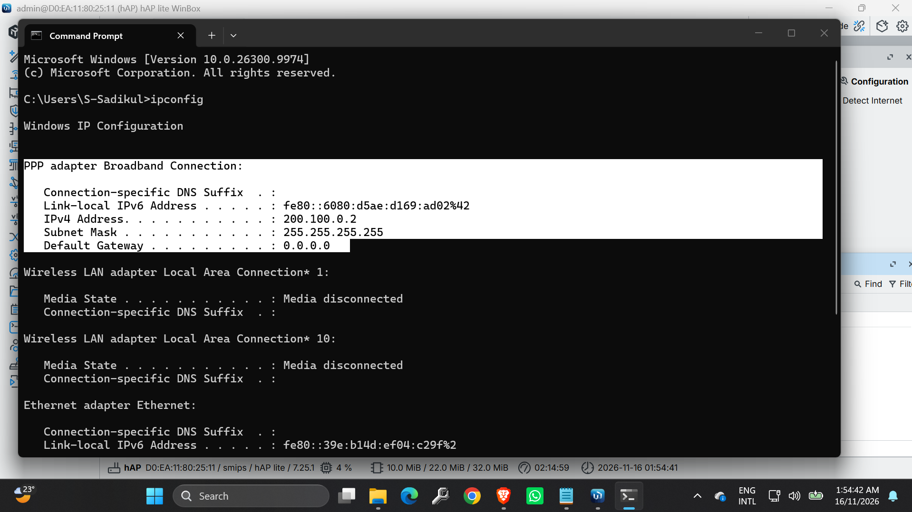
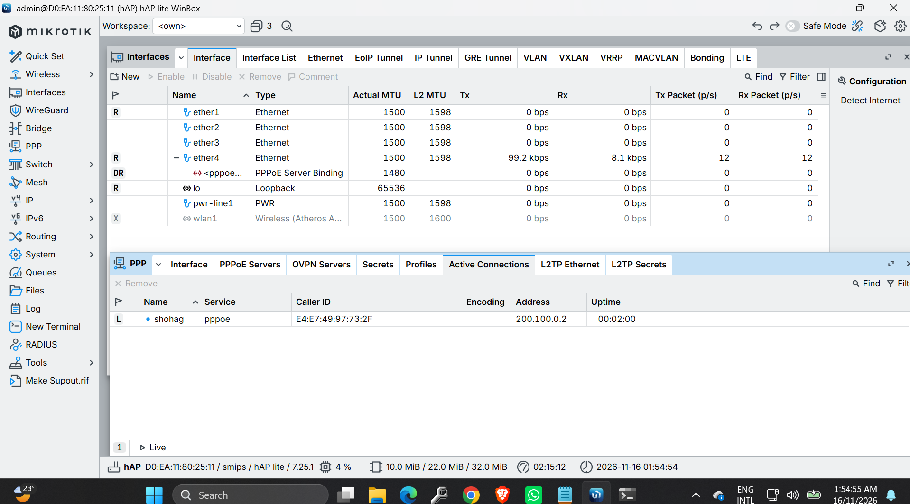
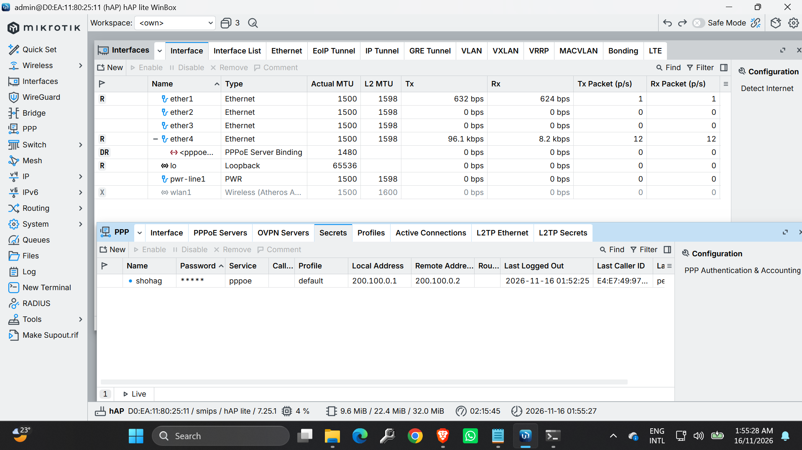
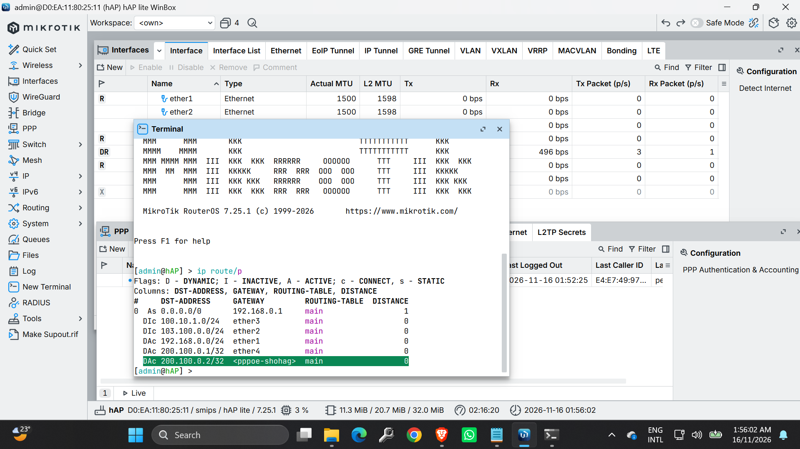

# MikroTik RouterOS PPPoE Server Configuration & Client Authentication Lab

A comprehensive, hands-on networking lab demonstrating the implementation of a **PPPoE (Point-to-Point Protocol over Ethernet) Server** on a **MikroTik hAP lite (RouterOS v7.25.1)** router. This project covers client authentication via PPP Secrets, dynamic point-to-point IP assignment, routing, and end-to-end connectivity verification.

---

## 🏗️ Lab Topology & Network Parameters

| Parameter | Configuration Details |
| :--- | :--- |
| **Router Model & OS** | MikroTik hAP lite (RouterOS v7.25.1) |
| **WAN Interface** | `ether1` (`192.168.0.0/24` network via Gateway `192.168.0.1`) |
| **PPPoE Server Interface** | `ether4` |
| **PPPoE Username / Secret** | `shohag` (Service: `pppoe`, Profile: `default`) |
| **Local Address (Gateway)** | `200.100.0.1` |
| **Remote Address (Client IP)** | `200.100.0.2/32` |

---

## ⚙️ Key Configuration Steps

1. **PPPoE Server Setup:** Enabled the PPPoE server service on the designated LAN interface (`ether4`) to listen and respond to incoming client connection requests.
2. **PPP Secret (User Authentication):** Configured a dedicated user secret (`shohag`) under the `pppoe` service, assigning a local gateway IP (`200.100.0.1`) and allocating a specific remote IP (`200.100.0.2`) to the client.
3. **Firewall NAT (Masquerade):** Setup Source NAT (`masquerade`) on the WAN interface (`ether1`) to allow authenticated PPPoE dial-up clients to access the internet.
4. **Client-Side Dial-Up:** Configured a Windows Broadband (PPPoE) connection using the authorized credentials and verified successful tunnel establishment.

---

## 📊 Testing & Verification Screenshots

### 1. Client Broadband IP Verification (`ipconfig`)


### 2. Active PPPoE Connection in WinBox


### 3. PPP Secret Configuration (`shohag`)


### 4. Dynamic Point-to-Point Route Verification (`/ip route print`)



## 💻 MikroTik RouterOS CLI Commands

```routeros
# 1. Enable PPPoE Server on Interface ether4
/interface pppoe-server server
add disabled=no interface=ether4 service-name=pppoe1

# 2. Create PPP Secret for Client Authentication
/ppp secret
add local-address=200.100.0.1 name=shohag password=****** remote-address=200.100.0.2 service=pppoe

# 3. Print Active Routes to Verify Point-to-Point Tunnel
/ip route print
